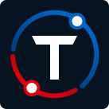
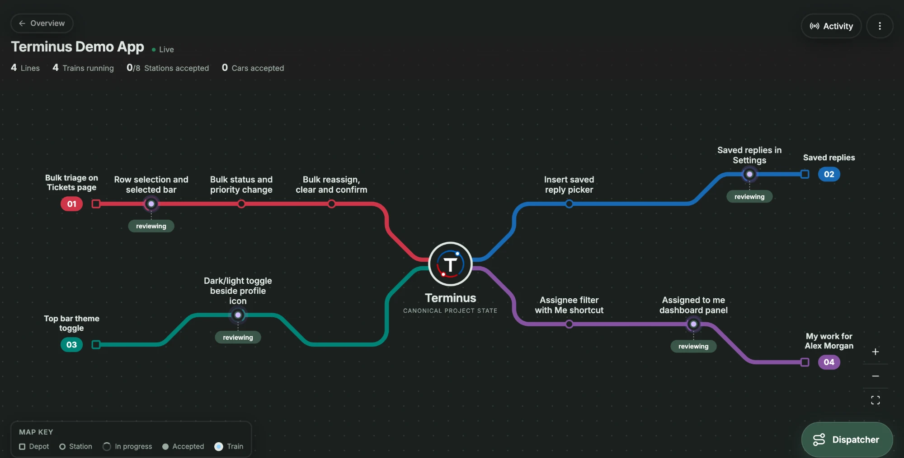
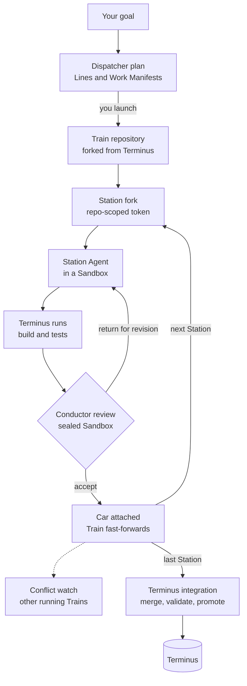
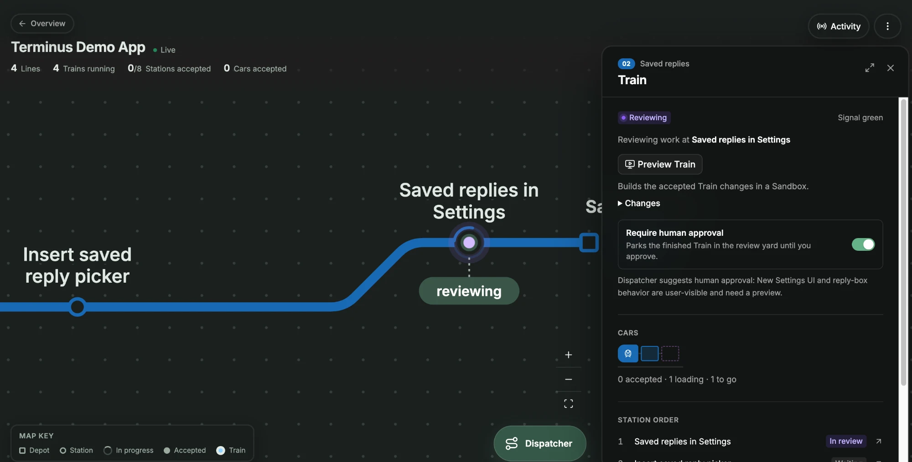
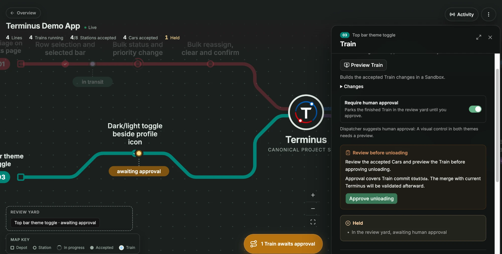

<p align="center">
  
</p>

<h1 align="center">Terminus</h1>

<p align="center"><strong>A new model for coordinating software development, built for teams of coding agents on Cloudflare Workers and Artifacts.</strong></p>

<p align="center">
  
  <a href="LICENSE"></a>
  
  
</p>

<p align="center">
  <a href="#try-it-in-five-minutes">Try it in five minutes</a> ·
  <a href="#how-terminus-handles-concurrent-agents">Concurrent agents</a> ·
  <a href="#how-it-works">How it works</a> ·
  <a href="#built-on-cloudflare">Built on Cloudflare</a>
</p>

<p align="center">
  
</p>

> [!NOTE]
> **Terminus is experimental.** Expect rough edges and breaking changes between versions. The offline demo is free, but running real agents is billed to your own Cloudflare account: read [Costs and access](#costs-and-access) before you go live.

Coding agents have gotten very good at writing code, but coordinating several of them on one project is still a mess. What can safely happen in parallel? How do agents avoid stepping on each other? How does everything come back together without a pile of merge conflicts?

**Terminus doesn't just coordinate agents. It introduces a different model for coordinating software development itself, organized like a railway network.** The Dispatcher breaks your goal into tasks (**Stations**), groups related work into **Lines** and sends out **Trains** to carry the results. Each Station's coding agent works in its own isolated Sandbox, and a Conductor reviews the work before it's added to the Train.

These aren't visual metaphors. Each Train carries a real, evolving Git repository in Cloudflare Artifacts with all the work it has accepted so far. Trains run independently, share accepted work through **Crossings** and come together at **Junctions** to build larger features. Once work has been reviewed and validated, it returns to **Terminus**, the project's canonical codebase. The map shows all of it: Trains move while agents work, Stations show their progress and signals make it obvious when something needs attention.

Terminus doesn't replace Git or your editor. It's the coordination layer that lets teams of coding agents work together, while you stay informed and in control of the decisions that matter.

## Try it in five minutes

No Cloudflare account, Docker or model calls are needed. The fake environment runs the real domain rules, D1 state and Workflows locally in workerd; only the coding agents and the Git repositories are simulated, so nothing is billed.

You need Node 24 (see `.nvmrc`) and npm.

```sh
git clone https://github.com/DaganCardinal/terminus.git
cd terminus
npm install
npm run dev:fake
```

In a second terminal, from the same folder:

```sh
npm run dev:web
```

Open the URL Vite prints (usually `http://localhost:5173`), then:

1. Enter any name in **Lay your first network** (later, choose **New network**), leave **Public Git URL** blank and choose **Create network**. Offline, every network uses a built-in sample project, and the network opens on its docs.
2. Choose **Network Map**. The Dispatcher panel opens.
3. Choose **Lay demo Lines**. Two Trains depart at once: the Red Line has two ordered Stations and the Blue Line has one.
4. Watch them run side by side. Each fake Conductor review returns the Station's work once for revision, then accepts it and attaches it to the Train as a Car. **Activity** shows the event log.
5. Returning Trains integrate into Terminus one at a time. Red unloads automatically; Blue waits in the review yard until you approve its accepted changes.

In a fresh network, **Lay Crossing demo** shows one Line picking up another Line's accepted work, and **Lay Junction demo** shows several Lines converging on one feature before Terminus. You can also type a goal to the Dispatcher; offline, it proposes a simple simulated plan that you review and launch.

`npm run stress:ten` runs ten concurrent Trains through the Workflows and checks the result against a real local Git oracle, also without credentials.

The Worker terminal can print `The Workers runtime canceled this request because it detected that your Worker's code had hung` while local Workflows wait; the run is fine as long as the map keeps advancing. To start over, stop both processes and delete `apps/worker/.wrangler`.

Train previews and real agents need live mode. To run real agents on real Artifacts repositories, see [Real repositories and agents](#real-repositories-and-agents) and [Deployment](#deployment). Both need a Workers Paid account with Artifacts and Sandboxes, and a network there needs a public npm project to import, such as [the demo app](https://github.com/DaganCardinal/term-demo-app); a blank URL creates a genuinely empty repository.

## How Terminus handles concurrent agents

| Challenge | How Terminus handles it |
| --- | --- |
| **Concurrency** | Every Line's Train runs in its own durable Workflow, and every Station runs in its own Sandbox on its own Artifacts fork. Trains run independently until they reach Terminus, except where the plan declares a dependency or Crossing. Per-network Sandbox limits are a setting, and `npm run stress:ten` runs ten Trains at once. |
| **Coordination** | The Dispatcher turns a goal into a persisted plan of Lines, Stations and dependencies, and nothing runs until you launch it. Each Train's Engineer enforces hard rules that no model can override: failed checks, unmet dependencies, holds and unresolved conflicts all stop the Train. [Crossings](docs/crossings.md) and [Junctions](docs/junctions.md) move accepted work between Lines on purpose. |
| **Context preservation** | A Work Manifest (goal, scope, areas to avoid, contracts, invariants, acceptance criteria, expected evidence) is a D1 domain object, not a prompt. Every Car records its manifest, agent configuration, commits, diff, evidence and review. Agent and model settings are frozen when work starts, and every state change writes a domain event in the same D1 batch. |
| **Review** | Terminus runs the checks itself and never trusts the agent's own summary. A Conductor agent then builds, tests and runs the exact candidate commit in a sealed, read-only Sandbox, and either accepts it as a Car or returns it for revision. Completed Trains can wait in the review yard for human approval bound to an exact commit. |
| **Conflict handling** | [Conflict watch](docs/conflict-watch.md) checks every accepted Car against the other running Trains and trial-merges suspicious pairs before they reach Terminus. Terminus integration uses merge commits and project-wide validation, and a failed merge goes to a [Technician](docs/technician.md), who prepares a reviewed repair in an isolated workspace for your approval. |

## Railway terms, mapped to Git

Terminus works on top of Git rather than replacing it, and the railway words are deliberate: each one is a domain object with its own rules, not a renamed Git feature.

| Terminus | Closest Git idea | What's different |
| --- | --- | --- |
| **Terminus** | `main` | The canonical project state. Only a Train that passes integration checks is promoted into it, with a merge commit. |
| **Line** | A long-running branch | An ordered workstream from a depot, through its Stations, to Terminus. Lines don't branch. |
| **Station** | An issue or task | One clearly defined job, described by a Work Manifest with scope, contracts and acceptance criteria. |
| **Train** | A feature branch | Its own Artifacts repository, forked from Terminus. It accumulates accepted work in order, and its Workflow is the only writer of its state. |
| **Car** | A merged pull request | One accepted unit of work with full provenance: manifest, agent configuration, commits, diff, evidence and review. |
| **Conductor** | A code reviewer | An agent that builds and runs the exact candidate before accepting it or returning it for revision. |
| **Engineer** | Branch protection and CI gates | Deterministic movement control: whether a Train may depart, wait, retry or stop. |
| **Review yard** | A pull request waiting for approval | Completed Trains held for human approval of an exact commit. |
| **Crossing** | Merging another branch in | A one-way pickup of another Line's accepted checkpoint, with provenance copied across. |
| **Junction** | An integration branch | Several Lines converge on one feature, which is reviewed and released before it heads to Terminus. |
| **Technician** | Resolving a merge conflict | An agent that repairs a failed integration in an isolated workspace and produces a reviewable candidate. |
| **Siding** | A closed pull request | An abandoned Train, parked but still inspectable. |

## How it works



1. **Plan.** The Dispatcher explores the project read-only at the exact Terminus commit and proposes Lines, Stations and Work Manifests. You review the plan and launch it.
2. **Depart.** Each Train gets its own Artifacts repository. When a Train departs toward a Station, that Station's workspace is forked from the Train's current state, and the Sandbox gets a short-lived token that can write only to that fork.
3. **Work.** The Station Agent (OpenCode by default, or Claude Code or Codex) implements the manifest. The Sandbox has no internet access except through the Worker, holds no credentials and is disposable.
4. **Review.** Terminus runs the project's checks itself, then the Conductor reviews the exact commit. Accepted work becomes a Car and fast-forwards the Train; returned work goes back for revision.
5. **Integrate.** Returning Trains reserve Terminus clearance one at a time. Terminus merges, validates the whole project and promotes the result. A failed merge goes to the Technician.

<p align="center">
  
  
</p>
<p align="center"><em>Left: a Conductor reviewing a Station's work. Right: a finished Train waiting in the review yard for approval of its exact commit.</em></p>

## Built on Cloudflare

Cloudflare isn't just hosting the app. Much of the architecture came from what these services make possible: they provide the Git infrastructure, execution environments, orchestration and AI that Terminus is built from.

| Product | What Terminus uses it for |
| --- | --- |
| **Artifacts** | The most important piece. Instead of every agent working against one repository, Terminus creates separate Git repositories for the canonical project state, each Train, each Station run, integration candidates and Technician workspaces, in one namespace per network. Accepted work is carried forward into the Train's repository as real commits and history. Sandboxes only ever receive short-lived, repo-scoped Git tokens. |
| **Workers** | One Worker serves the React app and the API, handles commands and mediates every Sandbox's outbound traffic. |
| **Workflows** | Every Train and Station has its own durable Workflow, as do integrations, Junctions, Dispatcher plans, Technician repairs and conflict watches. They wait for agents, trigger reviews, retry and integrate, without depending on one long-running process or an open browser tab. |
| **Sandboxes and Containers** | Where the coding happens. Each agent gets an isolated environment with a coding harness (OpenCode by default) to inspect the repository, edit files, install dependencies and run tests. Conductors review in separate, read-only Sandboxes, and Git, validation and previews run in agentless ones. |
| **D1** | The network itself: topology, Trains, Stations, Work Manifests, agent runs, Cars, reviews, settings and the domain event log that keeps the map current. |
| **Workers AI and AI Gateway** | Models for every role, configured independently and authenticated in the Worker, so credentials never enter a Sandbox. Cloudflare's Clef decision model makes some of the Engineer's operational choices, while hard rules such as failed tests and unresolved conflicts stay enforced in code. |
| **Cloudflare Access** | Authentication for the deployed app. |
| **R2** | A disposable npm dependency cache shared by Sandbox installs. |
| **Workers Builds** | Deploys a project's published Terminus state when you choose to publish. |

## Costs and access

The fake environment costs nothing. Live mode runs real agents on your own Cloudflare account, which is billed for:

- **Models**, for every role: Workers AI by usage, and Anthropic and OpenAI models through AI Gateway [Unified Billing](https://developers.cloudflare.com/ai-gateway/features/unified-billing/) credits. This includes local `npm run dev:worker`.
- **Sandboxes**, which are Containers. A deployment starts one for every Station run, Conductor review, Dispatcher plan, Technician repair, integration check and preview, and a Station returned for revision runs again (up to three automatic revisions by default). Under `npm run dev:worker` they run in your local Docker instead.
- **Workers, Workflows, D1, R2 and Artifacts** usage.

Cost grows with the number of Lines running at once, the models you choose and how often work is returned for revision. To keep it in check:

- Choose a smaller model preset in **Settings → Agents**. The default is Medium; Extra-light uses GLM-5.3 Flash for every text role.
- Lower the per-network Sandbox limits and sizes in **Settings → Sandboxes** (default 25 agent Sandboxes at standard-3 and 20 agentless at standard-2).
- Set AI Gateway spend limits if you use Anthropic or OpenAI models (see [Live setup](docs/live-setup.md#provider-routing)).
- Use **Emergency Brake** from a network's actions menu to stop all of its Station agents and hold the network. It doesn't stop Dispatcher, Conductor, integration, repair or preview containers.

The in-app stress test runs ten Trains on real Sandboxes and Artifacts with scripted Station agents and Conductor reviews, so its cost is mostly containers rather than models.

A deployment has no per-user permissions. Everyone listed in `ACCESS_ALLOWED_EMAILS` can see every network, launch and stop work, change Settings, approve unloading and publish, all billed to your account. Only add people you'd trust with that.

## Real repositories and agents

Live execution needs Docker, Cloudflare access to Artifacts and Sandboxes/Containers, two Worker secrets (`ARTIFACTS_API_TOKEN`, `AI_GATEWAY_TOKEN`), and a public HTTPS Git repository containing an npm project. Put local secrets in the ignored `apps/worker/.dev.vars`, start Docker, then run `npm run dev:worker` and `npm run dev:web`. Role harnesses and models are chosen in **Settings → Agents**; the default Medium preset uses GLM-5.3 for planning, reviews and repairs, Kimi K2.7 Code for Station work, and Clef for Engineer decisions.

See [Live setup](docs/live-setup.md) for token permissions, `.dev.vars`, harness and provider configuration, and troubleshooting.

## Deployment

One Worker hosts the React assets, API and Workflows, with separate agent and agentless Sandbox images. Deployment needs Node 24, Docker, a Cloudflare account with Workers Paid and Artifacts/Sandboxes available, an authenticated AI Gateway, and Zero Trust Access. Run `npm ci` from the repository root first. Deployment is a maintainer action.

### Configure account resources

`apps/worker/wrangler.jsonc` is shared and holds no deployment's values. Copy `apps/worker/wrangler.local.example.jsonc` to the ignored `apps/worker/wrangler.local.jsonc` and set your account, `ARTIFACTS_ACCOUNT_ID`, `AI_GATEWAY_ACCOUNT_ID`, `AI_GATEWAY_ID`, the app/Access origins and audience, and the preview domain and zone route. `npm run deploy` and `npm run dev:worker` merge it over `wrangler.jsonc`; `npm run dev:fake` ignores it. Run other remote Wrangler commands from `apps/worker` with `node scripts/wrangler.mjs` in place of `npx wrangler`.

From `apps/worker`, authenticate and create resources you have not already provisioned:

```sh
npx wrangler login
npx wrangler whoami
npx wrangler d1 create terminus
npx wrangler r2 bucket create terminus-dependency-cache
npx wrangler r2 bucket lifecycle add terminus-dependency-cache expire-cache --expire-days 30
```

Deploys and remote migrations find the D1 database by name, so its `database_id` is optional. The dependency bucket holds disposable npm caches; expired entries are rebuilt.

### Bootstrap and protect the Worker

Configure these Worker secrets; local `.dev.vars` are not deployed:

| Secret | Required value |
| --- | --- |
| `ARTIFACTS_API_TOKEN` | Account-scoped token with Artifacts Read and Edit |
| `AI_GATEWAY_TOKEN` | Account-scoped token with Workers AI Read, plus AI Gateway Run for native Anthropic/OpenAI routes |
| `ACCESS_ALLOWED_EMAILS` | Comma-separated emails permitted to use the app, each with full control (see [Costs and access](#costs-and-access)) |

For a first deployment, put all three in a temporary `NAME=value` secrets file outside the repository. Leave `APP_ORIGIN`, `ACCESS_TEAM_DOMAIN` and `ACCESS_AUD` empty until Access is configured; public requests fail closed. From the repository root:

```sh
npm run deploy -- --secrets-file /path/outside/repo/terminus-secrets.env
```

The deploy command applies remote D1 migrations, builds the web assets and deploys the Worker, Workflows and both container images. Delete the temporary secrets file afterward. Later deployments retain the stored secrets; change one with `node scripts/wrangler.mjs secret put NAME` from `apps/worker`.

Protect the Worker behind Cloudflare Access for all traffic, with an Allow policy limited to the intended emails. Then set:

- `APP_ORIGIN`: the exact public HTTPS origin, without a path.
- `ACCESS_TEAM_DOMAIN`: your `https://YOUR_TEAM.cloudflareaccess.com` origin.
- `ACCESS_AUD`: the Access application's Application Audience tag; multiple configured audiences are comma-separated.

Deploy again and sign in. Verify that logged-out requests to `/` and `/api/networks` require authentication. The Worker independently checks the Access JWT and allowed email; missing configuration returns 503 and rejected credentials return 403. Service tokens have no user email and cannot use this authentication path. Keep `ACCESS_REQUIRED` enabled in live deployments and `preview_urls: false`. Use `workers_dev: true` for the regular Worker URL, or a custom domain with `workers_dev: false`.

Application previews need additional wildcard DNS, TLS, routing and Access protection; see [Previews](docs/previews.md#deployment). Publishing managed project code is a separate explicit action through [Workers Builds](docs/publishing.md).

### Updates and verification

Run the [normal checks](#checks), finish active work before changing container images, then run `npm run deploy`. Migrations apply before deployment; deployment does not reset D1. Resetting D1 alone does not stop Workflows or remove containers and Artifacts repositories.

For a smoke test, import a public npm project, run two concurrent Lines, inspect accepted Cars and both integrations, test human unloading approval, and reload during execution. If previews are configured, verify the selected accepted snapshots and logged-out protection. The default Sandbox limits are 25 agent containers at standard-3 and 20 agentless containers at standard-2; adjust them through Settings rather than assuming a shared fixed cap. Before enabling Anthropic or OpenAI models under OpenCode, see [Harness selection](docs/harness-selection.md#release-verification).

## Checks

```sh
npm run typecheck
npm test
npm run lint
npm run format:check
npm run build
```

Worker tests run in workerd with D1 and Workflows. Repository transport tests use real, temporary local Git repositories. Model tests use mock transports; they do not incur inference charges. The current workerd Workflow tests can print cancellation messages during teardown even when assertions pass.

## Ten-Train stress test

```sh
npm run stress:ten
```

This runs the local ten-Train Workflow rehearsal and real local Git oracle, without Cloudflare credentials or Docker. For full Cloudflare verification, open **Stress test** from the app's Networks page, run the test, then **Verify and download report**. It creates its own fixture Network and uses your existing browser login. No manual project import, stress-mode switch, or terminal Access token is needed. See [the run guide](docs/pipeline-stress-test.md).

## Guides

| Guide | Covers |
| --- | --- |
| [Live setup](docs/live-setup.md) | Credentials, agents and models, provider routing, release gate, deployment |
| [Dispatcher planning](docs/dispatcher-planning.md) | Proposing, reviewing and launching plans; removing Stations; recovery |
| [Unloading and human approval](docs/unloading.md) | Auto-unload vs. review yard, commit-bound approval |
| [Station execution](docs/station-execution.md) | Station runs, evidence, revision allowance, Conductor review |
| [Terminus integration](docs/terminus-integration.md) | Clearance, merge/validate/promote, conflicts and recovery |
| [Technician repairs](docs/technician.md) | Reconciling failed Terminus merges |
| [Conflict watch](docs/conflict-watch.md) | Checking each accepted Car against other running Trains before they reach Terminus |
| [Crossings](docs/crossings.md) | Picking up another Line's accepted work |
| [Junctions](docs/junctions.md) | Multi-Line feature convergence before Terminus |
| [Previews](docs/previews.md) | Previewing a Train or Terminus, preview hostnames |
| [Publishing](docs/publishing.md) | Publishing Terminus to a publish repository and deploying it with Workers Builds |
| [API examples](docs/api.md) | Creating networks, validation commands, snapshots and events |
| [Pipeline stress test](docs/pipeline-stress-test.md) | Ten scripted Trains, real Git/Sandbox pipeline, correctness oracle and timing report |
| [Harness selection](docs/harness-selection.md) | Per-role harnesses, frozen configuration, release verification |
| [Browser Run transport gate](docs/browser-run.md) | Passed hosted transport proof, reproducible probes and remaining browser release requirements |

Architecture and ownership rules are in [AGENTS.md](./AGENTS.md), [the outline](./docs/outline-updated.md), and [technology architecture](./docs/technology-architecture.md).

## License

[MIT](LICENSE)
