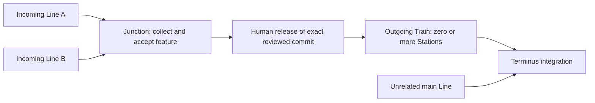

# Junctions: feature convergence before Terminus

A Junction collects a fixed feature from two or more incoming Lines. It owns a separate Artifacts repository forked at an exact, frozen Terminus commit. Every incoming Train starts at that same baseline. Accepted arrivals merge serially into the Junction while unfinished inputs and unrelated Lines continue independently. Only the outgoing Train can integrate this feature into canonical Terminus.

## Ownership and lifecycle

`packages/domain/src/junction.ts` defines the feature brief, immutable membership, accepted-input ledger, provenance and lifecycle. The brief describes goal, scope, contracts, invariants, acceptance criteria and validation commands; it is not an implementation Station. `packages/protocol` validates creation, proposals, reviews, release and repair commands. D1 stores these objects and the shared event log; Artifacts stores all code and accepted history.

One Junction Workflow is the only writer of Junction lifecycle state and schedules its input integrations. Each Train Workflow remains the only writer of its Train. The shared Integration Workflow prepares and promotes exact candidates for three purposes: Terminus, Crossing, and Junction. Source and target repository references are normalized at the protocol boundary; legacy `trainRepoId`/`terminusRepoId` fields remain compatible aliases.

The lifecycle is `collecting → reviewing → ready → released`. Failures move to `blocked`; explicit retry resumes collection or feature acceptance. `abandoned` is terminal. Membership, baseline, feature brief and routes stay fixed. V1 permits several independent Junctions per Network and rejects nested Junctions and cross-feature code transfers. There is no baseline refresh or partial release.

Lines normalize absent endpoints to depot → Terminus. Incoming Lines have a Junction destination; outgoing Lines have a Junction origin and may have no Stations. Crossings may exchange accepted checkpoints among incoming Lines of the same Junction. After release, outgoing Lines use ordinary main-Network Crossing rules. Topology validation includes edges through feature release so dependencies cannot create a cycle around a deferred outgoing route. Input route edits and Station removal are refused.

## Durable convergence and release

Creation forks stable repository identities, validates the entire topology, and persists the Junction, Lines, Stations, Crossings, incoming Trains and events in one D1 batch before starting Workflows. The outgoing Line is persisted immediately; its Train does not exist until release. Baseline/version triggers abort stale launches atomically.

Returning incoming Trains persist their entry requests in eligibility order. The Junction owner skips held or blocked members and reserves one integration at a time per target repository. Each integration uses exact source and target heads, an isolated merge candidate, independent project validation and configured Conductor compatibility review against the feature brief and accumulated work. Like every Conductor review, it runs in a Sandbox over a sealed checkout of the exact candidate, in its own Integration Workflow step. Promotion fast-forwards the exact candidate; Station credentials never authorize Junction writes.

A confirmed promotion stays `prepared` and retains target exclusion until the Junction owner atomically updates its head and input ledger, completes the receipt, records repair provenance and appends events. Incoming Train Workflows consume that acknowledged receipt and unload into the Junction. This unloading is distinct from canonical promotion and is excluded from Terminus history.

After every declared input is accepted, project and feature checks run on the assembled snapshot. The Conductor receives its actual baseline-to-feature diff, all Cars/manifests, independent evidence, integration reviews and Technician diffs. In live mode the Conductor verifies the Junction head in its own Sandbox, building and running the assembled feature, in a dedicated Junction Workflow step. Passing acceptance produces `ready`. Human release is a Dispatcher-owned command bound to that accepted commit; it does not waive holds, conflicts or checks.

Release forks a stable outgoing repository from the approved head, retains the original Terminus baseline, and copies Cars in input integration order, deduplicating by original Car identity. Original accepted commits, timestamps, manifests, evidence and reviews survive; immediate Car source and Junction transfer are recorded. Merge reviews and repairs remain separate records referenced by the outgoing Train. One batch creates the Train and copied Cars, records its configurable outgoing unload policy, releases the Junction, consumes approval and appends events. Stable Workflow startup recovers after this batch. Subsequent Stations fork the released head; final Terminus integration merges with any newer canonical work.

## Repair and recovery

Candidates, independent evidence, actual diffs, review feedback and exact failed sources stay inspectable. Retries are explicit. Unknown push outcomes keep their per-target reservation until Git can be reconciled. A push that succeeded must finish durable acknowledgement even if holds or abandonment arrive afterward. Persisted receipts and periodic gate checks recover missed notifications.

Technicians can repair Junction input conflicts or check/review failures, and failures of the assembled feature. These use typed failure references, not fabricated conflict records. Conflict repair scope is the recorded conflict files; other repairs require an explicit bounded list of repository-relative files. Git independently verifies parent history, baseline ancestry, actual repair edits and scope. Validation and Conductor review precede human approval of the exact repair candidate. Promotion records repair provenance, then reruns complete feature acceptance; repair approval never grants release approval.

Abandonment waits for active promotions to resolve, then requests siding through unfinished members' Train Workflows at safe gates. Accepted work and repositories remain inspectable. A member sided before acceptance blocks fixed membership; the feature can only be abandoned or its issue investigated, never partially released.

## API

| Method and path | Command |
| --- | --- |
| `POST /api/networks/:id/junctions` | Atomic creation; UUID `requestId` is idempotent only for an identical request |
| `GET /api/junctions/:id` | Junction, Cars, integration attempts, reviews, evidence and repairs |
| `GET /api/junctions/:id/repository` | Current feature tree |
| `GET /api/junctions/:id/repository/file?commit=...&path=...` | Exact commit-addressed contents |
| `POST /api/junctions/:id/release` | `{ "commit": "reviewed-head" }`; stale approvals return 409 |
| `POST /api/junctions/:id/retry` | Resume recorded failure, including reconciliation of uncertain promotion |
| `POST /api/junctions/:id/repairs` | `{ "failureId": "...", "scope": ["src/file.ts"] }`; conflict scope can be omitted |
| `POST /api/junctions/:id/repairs/:repairId/approve` | `{ "commit": "reviewed-candidate-head" }`; stale approvals return 409 |
| `POST /api/junctions/:id/abandon` | `{ "reason": "..." }` |
| `POST /api/networks/:id/demo/junctions` | Demonstration with two feature inputs, an outgoing App Station and unrelated main work |

The creation shape is `{requestId,name,brief,incoming:[{name,stations,route?},...],outgoing:{name,stations,route?,unloadMode?}}`. Station keys are unique across the feature; dependencies and planned Crossing sources resolve to stable identities before launch. Incoming acceptance is automatic; the outgoing policy defaults to auto and can use existing human unloading approval.

Dispatcher proposals add optional `junctions` with the same shape except `key` replaces `requestId`. Existing proposals remain valid. The launch persists all proposal topology atomically, including several features and ordinary Lines.

## Offline demonstration

Run `npm run dev:fake` and `npm run dev:web`. These use simulated repositories, agents, validation and review, with real local D1/Workflows. Create a fresh Network and select **Lay Junction demo** in the Dispatcher.

1. Watch Footer and Theme Lines run concurrently toward **Site components**. The independent Badge Line runs toward Terminus.
2. Confirm Badge can unload while the Junction collects. Select the Junction to inspect the frozen baseline, membership, integration order, accepted Cars and feature checks.
3. Wait for **Awaiting release**, reload, and confirm the outgoing Train still does not exist.
4. Review the combined diff, then **Approve and release feature**. Watch the outgoing Train run **Wire components into App** and integrate into newer Terminus.
5. Inspect Terminus history: only Badge and the outgoing feature Train are canonical integrations. Incoming unloading belongs to Junction history.

For a direct outgoing route, create a fresh Network and `POST /api/networks/NETWORK_ID/demo/junctions?direct=true`. For an internal Crossing use `?crossing=true`: Theme picks up the accepted Footer tests checkpoint before writing compatibility tests. Release still deduplicates inherited Cars.

For a scripted input conflict, set the existing `FAKE_INTEGRATION_CONFLICT_PATHS` to `src/App.tsx` in `env.fake.vars`, restart fake development and launch a fresh Junction demo. Inspect its recorded failure, dispatch Technician, inspect independently validated candidate/evidence/review, approve its exact head, then let collection resume. Restore the empty setting afterward. The fake conflict applies to ordinary integrations too; repair any affected main/output Train through its existing Terminus repair flow. Worker tests separately exercise assembled-feature review failure and bounded repair without human release permission.

## Live verification procedure

No deployment is required for local verification. Use the existing README live Artifacts/Sandbox prerequisites, Docker and a public committed demo baseline. `npm run dev:worker` applies additive `0012_junctions.sql`; both Wrangler environments include `JUNCTION_WORKFLOW`. Keep the configured Extra-light role preset (`@cf/zai-org/glm-5.3-flash`) as the maintainer requires.

1. Import a fresh demo Network and launch the same Junction demo. Save baseline B. Verify the Junction and both input repositories start at B, outgoing topology exists, and no outgoing repository/Train executes before release.
2. Allow the independent Badge Line to advance Terminus. Confirm incoming accepted commits merge only into the Junction and all accepted Car commits remain reachable in Git.
3. Inspect every candidate's exact parents, independent project checks and compatibility review. After feature acceptance inspect the complete B→J diff and additional feature-test evidence. Refresh while ready to demonstrate persistence.
4. Send a stale release and expect 409; approve the actual accepted head. Confirm a single outgoing Train/repository and stable copied Car identities, original timestamps and original accepted commits. Check App's Station repository starts at released J, then verify final canonical merge contains J and Badge work.
5. Repeat on fresh Networks with `?direct=true`, `?crossing=true`, and two independent Junction creation requests. Verify targets serialize within a Junction while different targets proceed concurrently.
6. For Technician verification, deliberately give two inputs incompatible edits to one bounded file, or make a feature criterion/check fail. Inspect the blocked failure, preserved source heads and candidate; dispatch with exact conflict files or explicit file scope. Attempt an out-of-scope edit/stale candidate approval and verify refusal. Approve a valid exact candidate, confirm its history is promoted without Station Cars, then rerun complete acceptance and require separate release approval.
7. Exercise an active hold and duplicate command; verify no release bypass. Simulate a lost notification/restart, inspect retained receipts and reservations, and retry an uncertain push only after reconciling the actual target head. Side an unfinished member and verify the Junction blocks; abandon and confirm unfinished members side at safe gates while accepted repositories remain inspectable.

Automated coverage uses pure domain/protocol tests, real local Git repair tests, Worker/D1 orchestration and actual Workflow API demonstrations. Live provider/model behavior and actual remote failure injection require the maintainer's live environment; offline evidence is explicitly simulated. Deployment remains a separate maintainer action.
